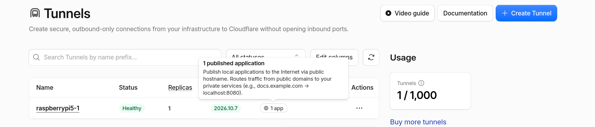
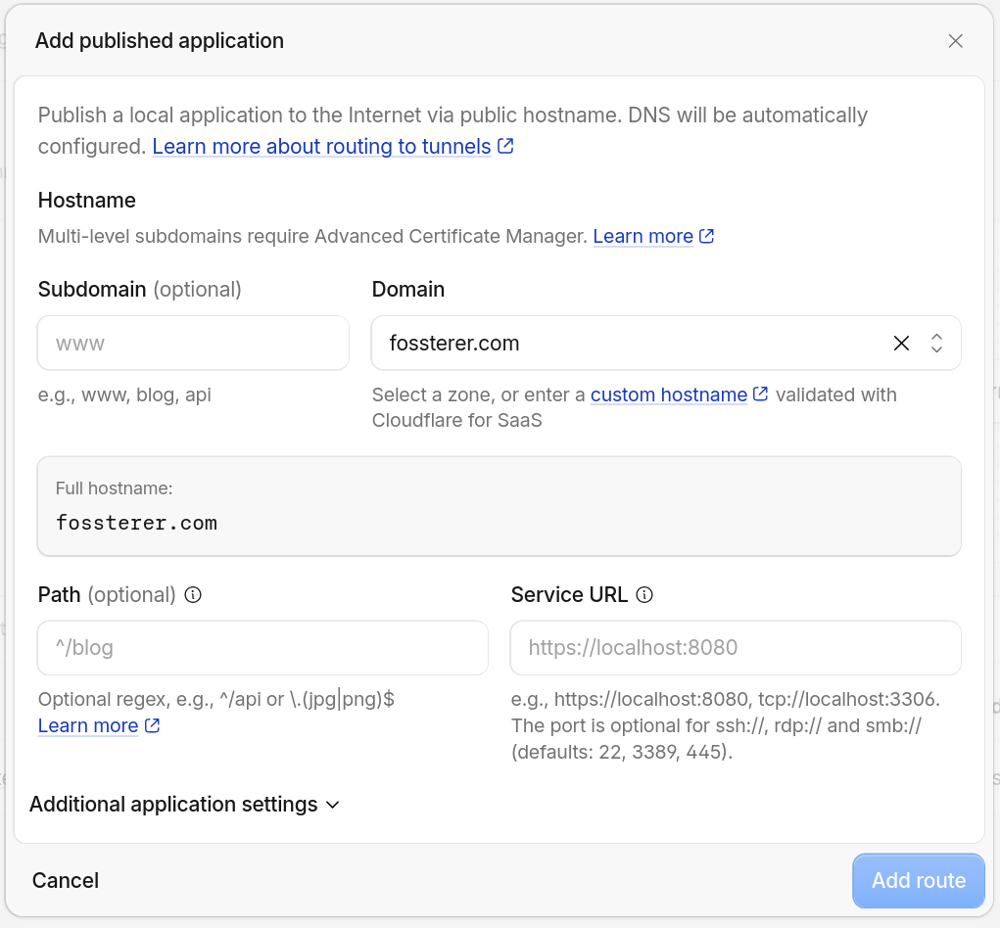
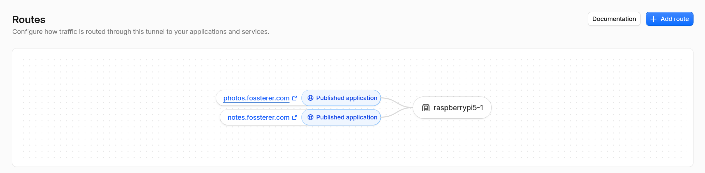

# Hosting Services Series - Part 8 - Adding second public service to existing CloudflareD

I've configured and tested successfully the [Kept](https://github.com/ericerkz/kept) an alternative (may I say 'Improved!'?) service on my RaspberryPi.

I've already made one service earlier public, using [Cloudflare Tunnel](https://hub.docker.com/r/cloudflare/cloudflared) approach.

Let's use the same daemon but add a second route to this new service now!

## Steps

- Cloudflare Dash shows that we have 1 tunnel with 1 published application 
- I Added 1 more 'Published Application' to point to my second 'Private Service'. Not create a second tunnel 
- Done! 
