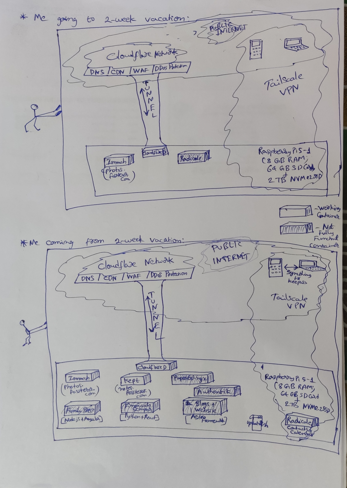
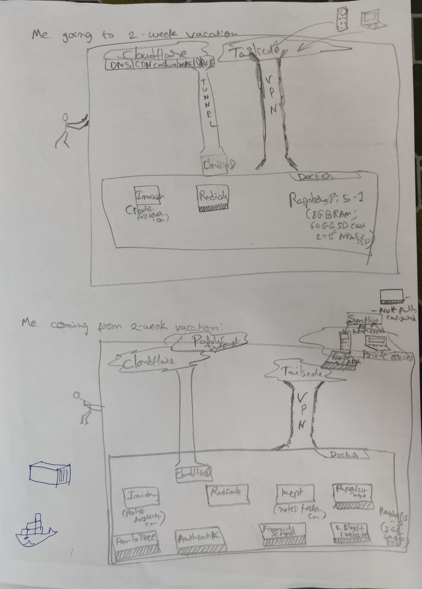

# Hosting Services Series: Architecture Diagram (Part-9)

Remember [Hosting Services Series: Laying out architecture (Part-2)](hosting-services-series-part-2.md) from Jan 01 2021? :D

The plan is being realized. Follow other posts in this series where I identified specific services being replaced.

At the start of my 2 week vacation, I had 3 containers on RaspberryPi - 1 not fully functional yet.

By the end, I have/will have 10 containers on RaspberryPi - 1 container on my laptop rather than RaspberryPi (surprising, I know!), 1 container restricted to private network and 5 not fully functional yet.

*For better stick figures :D see this*

